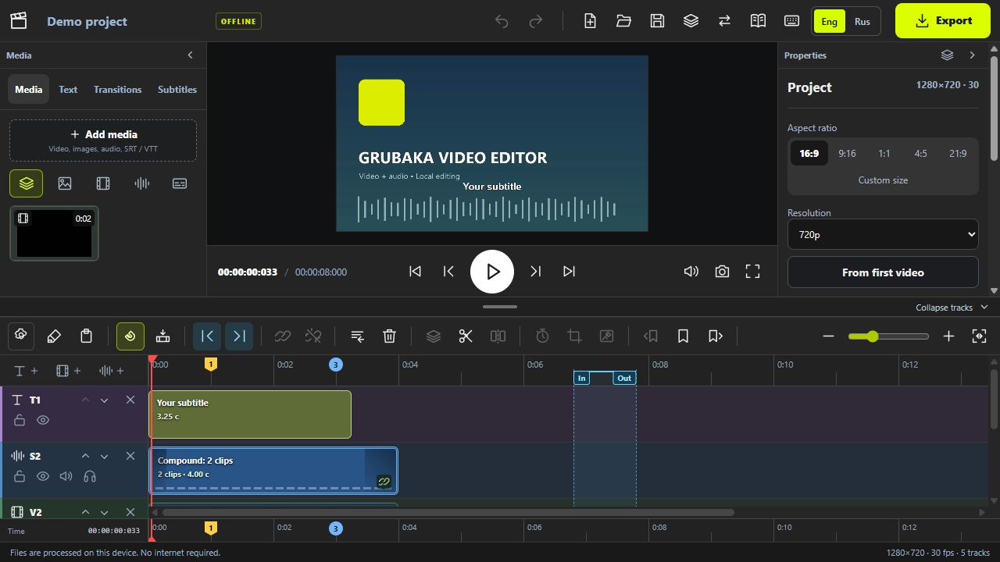
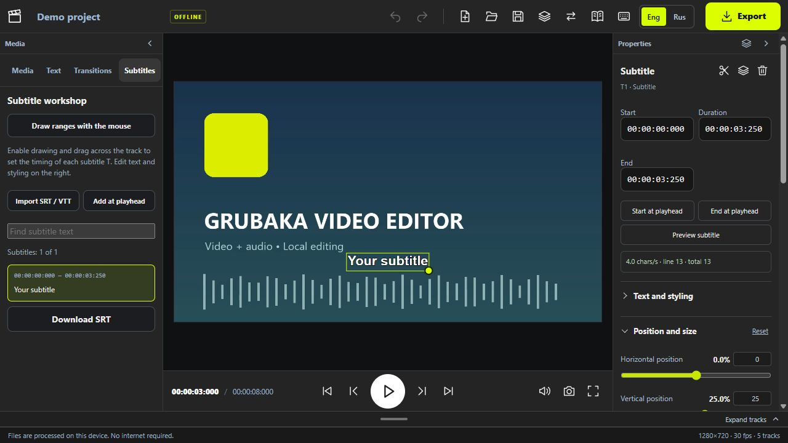
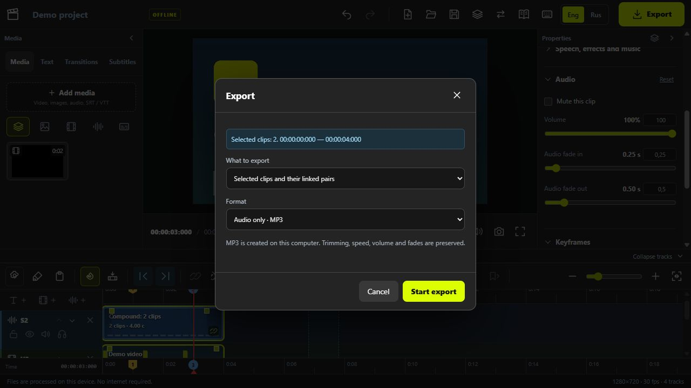

# Grubaka Video Editor

[English](#english) · [Русский](#русский)

## English

A local video editor for Windows with a multitrack timeline, linked video and audio, captions, timers, chroma key, cropping, slow motion, video conversion, and audio separation into speech, music and effects.

**English / Русский:** the **Eng / Rus** switch changes buttons, menus, properties and tooltips without reloading. Your choice is saved and shared with the converter, slow motion tool and built-in guide. User text and filenames are kept as entered. The bilingual guide, `editor/guide.html`, includes search and screenshots with arrows and numbers in the selected language. Update both languages in this file when adding documentation.

### Features

- Multitrack editing of video, images, audio, text and subtitles.
- Linked video and audio move, trim and split together; unlink them for independent editing.
- Shift selection, merging and unmerging clips, ripple deletion and closing gaps.
- Video thumbnails, audio waveforms, colored markers with numbers and captions, and range selection between markers.
- Mouse-driven picture cropping, chroma key compositing, and 2× / 4× / 8× slow motion.
- Counters and timers with linked audio that can be edited separately.
- Transitions, keyframes, color adjustments, text styling and a subtitle workshop.
- Searchable project versions with deletion, autosave, and project transfer using JSON.
- Export the project, selected clips or MP3 audio; convert video and separate audio into speech, music and effects.
- An illustrated English and Russian guide with search, screenshots, arrows and numbered controls.

### Screenshots

#### Workspace

Media, video preview, clip properties and timeline tracks in one window.



#### Text and subtitles

Edit caption text, timing, position and size directly in the editor.



#### Video and audio export

Save the whole edit, selected clips, or audio only as MP3.



### Repository layout

- `Start Offline Editor.bat` — launches the browser version from the package root.
- `editor/` — browser editor files; the launcher enters this folder automatically.
- `desktop/` — Electron shell with a dedicated window, internal server, project saving on exit and processing shutdown when the app closes.
- `tools/build-windows.py` — assembles the Windows application in a separate folder.

The built application, FFmpeg, Python, PyTorch and model weights are not stored in Git. Application archives are intended for GitHub Releases. Source footage, user projects, machine-specific settings and autosave data are excluded.

### Run the offline browser version

Install Node.js. Put `ffmpeg.exe` and `ffprobe.exe` in `editor/bin/` (source and licensing: `editor/bin/SOURCE.txt`), then run **`Start Offline Editor.bat` from the package root**. You do not need to move it into `editor/`. For audio separation, configure `editor/audio-engine.local.json` using `editor/audio-engine.example.json` as a template.

### Build the Windows application

Requires Windows x64, Node.js, Python 3.11 x64 and the `numpy`, `torch`, `soundfile` and `Pillow` packages. The builder copies the required libraries from your chosen Python environment without modifying it.

```powershell
npm install
python tools/build-windows.py --ffmpeg-dir "C:/tools/ffmpeg/bin" --weights "C:/models/checkpoint-multi.ckpt"
```

To use another Python environment, add `--python-base` (the base Python folder) and `--site-packages`. Launch the resulting `dist/Монтажная/Монтажная.exe`. Copy the entire application folder when moving it. The built EXE does not require a separate Node.js installation.

Bandit v2 Multi weights: [official download](https://zenodo.org/records/12701995), file `checkpoint-multi.ckpt`, SHA256 `abcfccf65446752a057f4a302c941479a54b7560ebf8d7bca039d2ea98e64cfc`. Once assembled, file processing does not require a network connection. A suitable PyTorch build with CUDA accelerates audio separation; otherwise it runs on the CPU.

### Data and project transfer

The desktop app stores settings, projects, media and versions in `%APPDATA%/Montazhnaya Desktop`. Its storage is separate from the browser version. To move an edit, save its JSON in the old editor, open it in the app and add the original media again so files can be matched by name.

### Third-party components

- Electron / Chromium — licenses are included in the built application.
- FFmpeg — GPLv3; see `editor/bin/`.
- Bandit / bandit-infer — Apache-2.0; see `editor/vendor/`.
- Bandit v2 weights — CC BY-SA 4.0, Karn Watcharasupat and coauthors; source linked above.
- lamejs — see `editor/LICENSE-lamejs.txt`.
- Python, PyTorch and dependencies — licenses are copied into the application alongside their libraries.

Audio separation may leave traces of other components; results depend on the source recording.

---

## Русский

Локальный видеоредактор для Windows: многодорожечный монтаж, связанное видео и звук, титры, счётчики, хромакей, обрезка, слоумоушен, конвертация и разделение аудио на речь, музыку и эффекты.

**Русский / English:** переключатель **Eng / Rus** в верхней панели меняет язык кнопок, меню, свойств и подсказок без перезагрузки. Выбор сохраняется и используется в конвертере и слоумоушене. Пользовательский текст и названия файлов не переводятся. Инструкция `editor/guide.html` содержит русский и английский тексты, включая поиск и пояснения к иллюстрациям, и открывается на выбранном языке редактора. При добавлении разделов обновляйте оба языка в этом же файле.

### Возможности

- Многодорожечный монтаж видео, фото, звука, текста и субтитров.
- Связанные видео и звук: совместное перемещение, обрезка и разрезание; независимый монтаж после отвязки.
- Выделение нескольких ячеек через Shift, объединение и разъединение, удаление со сдвигом и закрытие промежутков.
- Миниатюры видео, звуковая волна, цветные метки с номерами и подписями, выделение участка между метками.
- Обрезка кадра мышкой, хромакей для наложения видео и слоумоушен 2× / 4× / 8×.
- Счётчики и таймеры с отдельно редактируемым связанным звуком.
- Переходы, ключевые кадры, цветовые настройки, оформление текста и мастерская субтитров.
- Версии проекта с поиском и удалением, автосохранение и перенос монтажа через JSON.
- Экспорт проекта, выделенных ячеек или звука в MP3; конвертация видео и разделение аудио на речь, музыку и эффекты.
- Инструкция на русском и английском с поиском, скриншотами, стрелками и номерами.

### Скриншоты

#### Рабочее пространство

Медиа, просмотр видео, свойства клипа и дорожки монтажа в одном окне.


#### Текст и субтитры

Редактирование текста, времени показа, положения и размера прямо в редакторе.


#### Экспорт видео и звука

Можно сохранить монтаж целиком, выбранные ячейки или только звук в MP3.


### Структура

- `Start Offline Editor.bat` — запуск браузерной версии из корня комплекта.
- `editor/` — файлы браузерного редактора; BAT сам переходит в эту папку.
- `desktop/` — оболочка Electron: отдельное окно, внутренний сервер, сохранение проекта при выходе, остановка обработки вместе с приложением.
- `tools/build-windows.py` — сборка приложения в отдельную папку.

Готовое приложение, FFmpeg, Python, PyTorch и веса модели не хранятся в Git. Архивы приложения предназначены для GitHub Releases. Исходные видео, пользовательские проекты, настройки компьютера и автокопии не включены.

### Запуск версии с BAT

Нужен Node.js. Разместите `ffmpeg.exe` и `ffprobe.exe` в `editor/bin/` (источник и лицензия: `editor/bin/SOURCE.txt`), затем запустите `Start Offline Editor.bat` из корня комплекта. Перемещать его в `editor/` не требуется. Для разделения аудио настройте `editor/audio-engine.local.json` по образцу `audio-engine.example.json`.

### Сборка Windows-приложения

Нужны Windows x64, Node.js, Python 3.11 x64 и библиотеки `numpy`, `torch`, `soundfile`, `Pillow`. Сборщик копирует только необходимые библиотеки из выбранной Python-среды, не меняя её.

```powershell
npm install
python tools/build-windows.py --ffmpeg-dir "C:/tools/ffmpeg/bin" --weights "C:/models/checkpoint-multi.ckpt"
```

Для указания другой Python-среды добавьте `--python-base` (папка базового Python) и `--site-packages`. Запускайте полученный `dist/Монтажная/Монтажная.exe`. Копировать нужно всю папку приложения. Node.js для запуска готового EXE не нужен.

Веса Bandit v2 Multi: [официальная загрузка](https://zenodo.org/records/12701995), файл `checkpoint-multi.ckpt`, SHA256 `abcfccf65446752a057f4a302c941479a54b7560ebf8d7bca039d2ea98e64cfc`. Обработка файлов после сборки не требует сети. Для ускорения разделения установите подходящую сборку PyTorch с CUDA; иначе оно работает на CPU.

### Данные и перенос проектов

Настройки, проекты, медиа и версии приложения находятся в `%APPDATA%/Montazhnaya Desktop`. Хранилище приложения отдельно от хранилища браузера. Для переноса сохраните JSON в старом редакторе, откройте его в приложении и добавьте исходные медиа повторно для восстановления связей по именам.

### Сторонние компоненты

- Electron / Chromium — лицензии входят в готовую сборку.
- FFmpeg — GPLv3, см. `editor/bin/`.
- Bandit / bandit-infer — Apache-2.0, см. `editor/vendor/`.
- Веса Bandit v2 — CC BY-SA 4.0, Karn Watcharasupat и соавторы; источник указан выше.
- lamejs — см. `editor/LICENSE-lamejs.txt`.
- Python, PyTorch и зависимости — лицензии копируются в готовую сборку вместе с библиотеками.

Нейросетевое разделение может оставлять остатки других компонентов; качество зависит от исходной записи.
