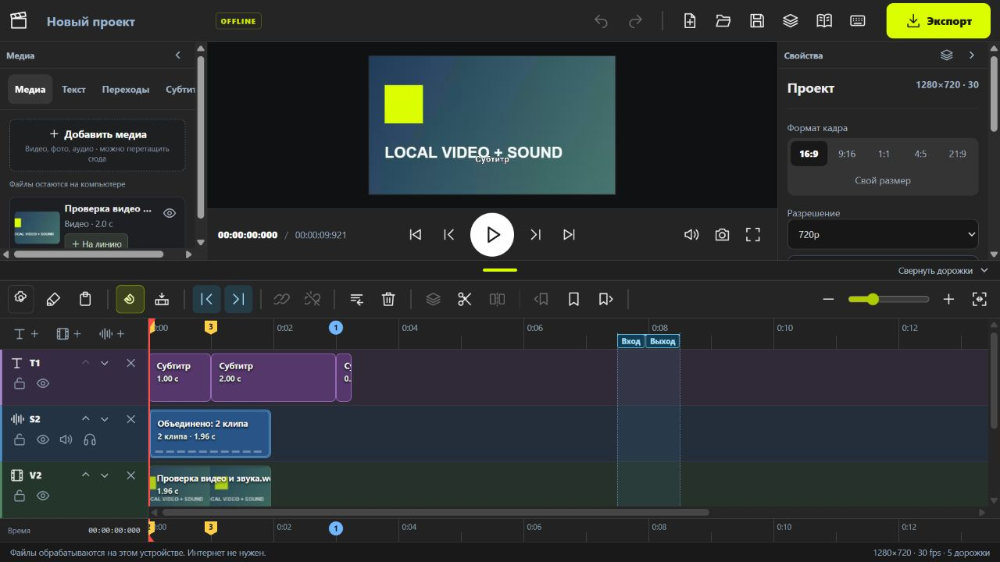
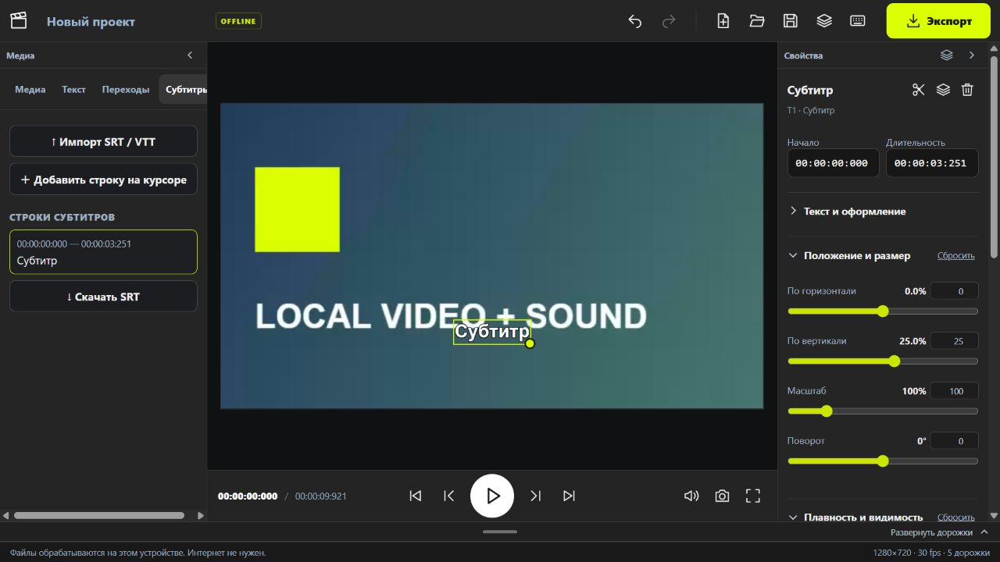
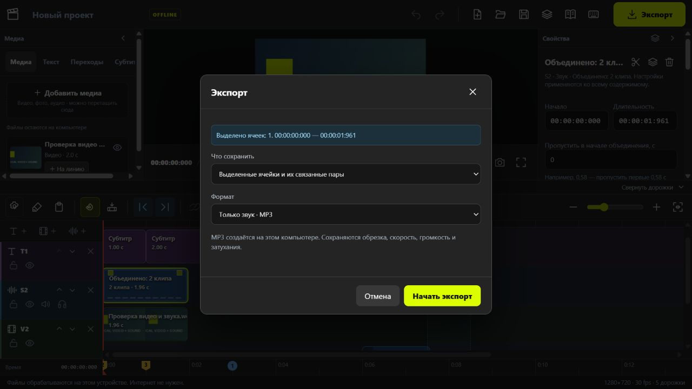

# Grubaka Video Editor

Локальный видеоредактор для Windows: многодорожечный монтаж, связанное видео и звук, титры, счётчики, хромакей, обрезка, слоумоушен, конвертация и разделение аудио на речь, музыку и эффекты.

**Русский / English:** переключатель **Eng / Rus** в верхней панели меняет язык кнопок, меню, свойств и подсказок без перезагрузки. Выбор сохраняется и используется в конвертере и слоумоушене. Пользовательский текст и названия файлов не переводятся. Инструкция `editor/guide.html` содержит русский и английский тексты, включая поиск и пояснения к иллюстрациям, и открывается на выбранном языке редактора. При добавлении разделов обновляйте оба языка в этом же файле.

## Скриншоты

### Рабочее пространство

Медиа, просмотр видео, свойства клипа и дорожки монтажа в одном окне.



### Текст и субтитры

Редактирование текста, времени показа, положения и размера прямо в редакторе.



### Экспорт видео и звука

Можно сохранить монтаж целиком, выбранные ячейки или только звук в MP3.



## Структура

- `editor/` — версия для браузера, запускаемая через BAT / Node.js.
- `desktop/` — оболочка Electron: отдельное окно, внутренний сервер, сохранение проекта при выходе, остановка обработки вместе с приложением.
- `tools/build-windows.py` — сборка приложения в отдельную папку.

Готовое приложение, FFmpeg, Python, PyTorch и веса модели не хранятся в Git. Архивы приложения предназначены для GitHub Releases. Исходные видео, пользовательские проекты, настройки компьютера и автокопии не включены.

## Запуск версии с BAT

Нужен Node.js. Разместите `ffmpeg.exe` и `ffprobe.exe` в `editor/bin/` (источник и лицензия: `editor/bin/SOURCE.txt`), затем запустите `editor/Запустить редактор.bat`. Для разделения аудио настройте `editor/audio-engine.local.json` по образцу `audio-engine.example.json`.

## Сборка Windows-приложения

Нужны Windows x64, Node.js, Python 3.11 x64 и библиотеки `numpy`, `torch`, `soundfile`, `Pillow`. Сборщик копирует только необходимые библиотеки из выбранной Python-среды, не меняя её.

```powershell
npm install
python tools/build-windows.py --ffmpeg-dir "C:/tools/ffmpeg/bin" --weights "C:/models/checkpoint-multi.ckpt"
```

Для указания другой Python-среды добавьте `--python-base` (папка базового Python) и `--site-packages`. Запускайте полученный `dist/Монтажная/Монтажная.exe`. Копировать нужно всю папку приложения. Node.js для запуска готового EXE не нужен.

Веса Bandit v2 Multi: [официальная загрузка](https://zenodo.org/records/12701995), файл `checkpoint-multi.ckpt`, SHA256 `abcfccf65446752a057f4a302c941479a54b7560ebf8d7bca039d2ea98e64cfc`. Обработка файлов после сборки не требует сети. Для ускорения разделения установите подходящую сборку PyTorch с CUDA; иначе оно работает на CPU.

## Данные и перенос проектов

Настройки, проекты, медиа и версии приложения находятся в `%APPDATA%/Montazhnaya Desktop`. Хранилище приложения отдельно от хранилища браузера. Для переноса сохраните JSON в старом редакторе, откройте его в приложении и добавьте исходные медиа повторно для восстановления связей по именам.

## Сторонние компоненты

- Electron / Chromium — лицензии входят в готовую сборку.
- FFmpeg — GPLv3, см. `editor/bin/`.
- Bandit / bandit-infer — Apache-2.0, см. `editor/vendor/`.
- Веса Bandit v2 — CC BY-SA 4.0, Karn Watcharasupat и соавторы; источник указан выше.
- lamejs — см. `editor/LICENSE-lamejs.txt`.
- Python, PyTorch и зависимости — лицензии копируются в готовую сборку вместе с библиотеками.

Нейросетевое разделение может оставлять остатки других компонентов; качество зависит от исходной записи.
